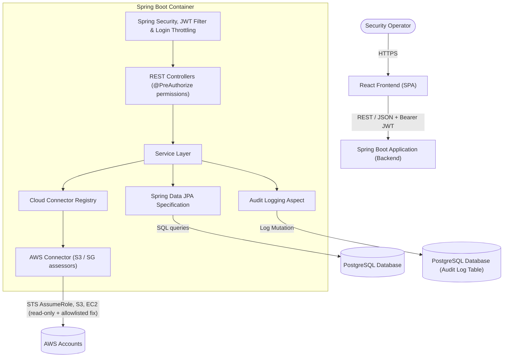
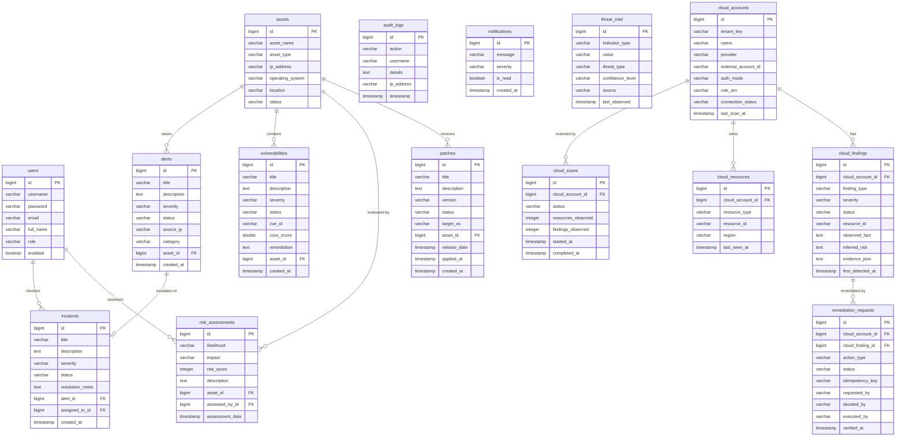
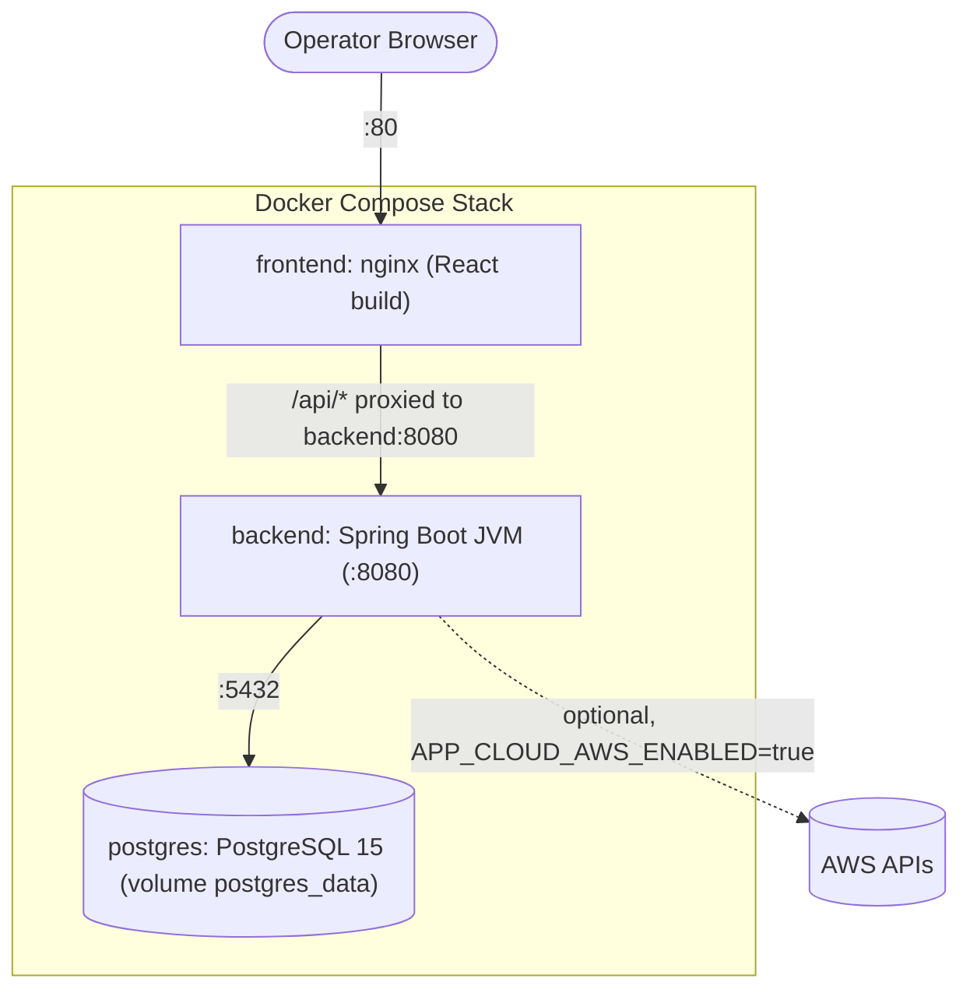

# SentinelCore Security Platform

SentinelCore is an enterprise-grade Security Operations and Infrastructure Monitoring platform. It provides organizations with real-time asset visibility, automated vulnerability tracking, threat intelligence feed integration, structured incident escalation queues, interactive risk matrices, AWS cloud security posture management with an approval-gated remediation workflow, an in-app security assistant, and platform-wide mutation audit logs.

---

## ✨ Features

| Module | What it does |
| :--- | :--- |
| **Dashboard** | Live stats and Recharts visualizations across assets, alerts, incidents and vulnerabilities |
| **Assets** | Inventory with search, sort and paging; Excel export |
| **Alerts & Incidents** | Alert triage and escalation to incidents with assignment and resolution notes; PDF incident report |
| **Vulnerabilities** | CVE / CVSS tracking per asset with remediation guidance |
| **Threat Intel** | IOC feed (IP, domain, file hash, URL) with threat type and confidence |
| **Risk Assessment** | Likelihood × impact risk matrix per asset |
| **Patch Management** | Patch catalogue and deployment tracking |
| **Cloud Security (AWS)** | Read-only S3 / security-group assessment, evidence-backed findings, approval-gated remediation ([details](docs/cloud-security.md)) |
| **Users & RBAC** | 8 roles (`SUPER_ADMIN`, `ADMIN`, `SECURITY_ANALYST`, `INCIDENT_MANAGER`, `VULNERABILITY_MANAGER`, `ASSET_MANAGER`, `AUDITOR`, `USER`) mapped to fine-grained permissions |
| **Audit Logs** | Every mutation recorded by an AOP aspect, with sensitive values sanitized |
| **Notifications & Chatbot** | In-app notifications and the SentinelChatbot assistant |

---

## 📁 Project Structure

```
sentinelcore-security-platform/
├── backend/                          # Spring Boot API (Java 21)
│   ├── src/main/java/com/sentinelcore/backend/
│   │   ├── cloud/                    # Cloud provider abstraction + connector registry
│   │   │   └── aws/                  # AWS connector, S3 & security-group assessors, error mapping
│   │   ├── config/                   # Admin bootstrap, CORS, OpenAPI, audit logging aspect
│   │   ├── controller/               # REST controllers (/api/**)
│   │   ├── dto/                      # Request/response DTOs (dto/cloud for cloud security)
│   │   ├── entity/                   # JPA entities, Role & Permission enums
│   │   ├── exception/                # Global exception handler + typed exceptions
│   │   ├── mapper/                   # Entity ↔ DTO mappers
│   │   ├── repository/               # Spring Data JPA repositories
│   │   ├── security/                 # SecurityConfig, JWT filter/service, login throttling
│   │   └── service/                  # Business logic (incl. CloudScan & Remediation services)
│   ├── src/main/resources/application.properties
│   ├── src/test/                     # Unit + integration tests (H2, mocked AWS)
│   ├── Dockerfile                    # Multi-stage Maven → JRE image (non-root)
│   ├── .dockerignore
│   ├── pom.xml
│   ├── mvnw / mvnw.cmd               # Maven wrapper
│   └── .env.example                  # Backend environment variables (local run)
│
├── frontend/                         # React 19 SPA (Vite 8 + MUI + Tailwind)
│   ├── src/
│   │   ├── components/               # auth guards, cards, charts, common (chatbot, snackbar), dashboard,
│   │   │                             # forms, layout (Navbar, UserMenu…), originkit (Fibre Arc background)
│   │   ├── context/                  # ThemeContext
│   │   ├── layouts/                  # MainLayout
│   │   ├── pages/                    # Dashboard, Assets, Alerts, Incidents, Vulnerabilities, ThreatIntel,
│   │   │                             # RiskAssessment, PatchManagement, CloudSecurity, AuditLogs, Reports,
│   │   │                             # Users, Profile, Settings, Login, LandingPage
│   │   ├── routes/                   # AppRoutes (permission-guarded routes)
│   │   ├── services/                 # Axios API client + one service per module
│   │   ├── test/                     # Vitest setup
│   │   └── theme/                    # MUI theme
│   ├── Dockerfile                    # Multi-stage Node build → nginx image
│   ├── nginx.conf                    # SPA fallback + /api reverse proxy to the backend
│   ├── .dockerignore
│   ├── vercel.json                   # SPA rewrites for Vercel deployments
│   ├── vite.config.js                # Vite + Vitest config
│   ├── package.json
│   └── .env.example                  # Frontend environment variables
│
├── docs/
│   ├── cloud-security.md             # AWS setup, IAM policies, remediation workflow
│   └── security-audit.md             # Security audit, DB changes, rollback
├── .github/workflows/ci.yml          # CI: backend tests + frontend build
├── docker-compose.yml                # Full stack: PostgreSQL + API + nginx frontend
├── .env.example                      # Docker Compose variables (copy to .env)
├── LICENSE.txt
└── README.md
```

### Quick Start

1. **Docker** (full stack, recommended):
   ```bash
   cp .env.example .env        # set JWT_SECRET and APP_BOOTSTRAP_ADMIN_PASSWORD
   docker compose up --build -d
   # App: http://localhost   API: http://localhost:8080
   ```

2. **Backend** (`backend/`):
   ```bash
   cd backend
   ./mvnw spring-boot:run
   # Runs at http://localhost:8080 (env vars: see backend/.env.example)
   ```

3. **Frontend** (`frontend/`):
   ```bash
   cd frontend
   cp .env.example .env
   npm install
   npm run dev
   # Opens at http://localhost:5173
   ```

---

## 🎨 Background — Originkit "Fibre Arc"

The app background uses the Originkit **Fibre Arc** WebGL component, installed via:

```bash
export ORIGINKIT_API_KEY=<your-originkit-api-key>   # never commit the real key
npx originkit@latest add fibre-arc --prompt
```

The component lives at `frontend/src/components/originkit/ui/fibre-arc.jsx` and is rendered as a full-screen animated background in `frontend/src/layouts/MainLayout.jsx`.


## 🏗️ Architecture Diagrams

### 1. System Architecture
The platform is designed around a multi-layered decoupled client-server architecture:


### 2. Entity-Relationship (ER) Diagram
The PostgreSQL relational model maps system assets to alerts, incidents, vulnerability indexes, and risk profiles:


### 3. Deployment Topology
Docker Compose stack (`docker-compose.yml`):

The frontend can also be deployed to **Vercel** (`frontend/vercel.json` provides SPA rewrites); set `VITE_API_BASE_URL` to the public API URL and add the Vercel origin to `CORS_ALLOWED_ORIGINS` / `CORS_ALLOWED_ORIGIN_PATTERNS` on the backend.

---

## 🛠️ Technology Stack

### Backend
- **Java 21** & **Spring Boot 3.5.5**
- **Spring Security** (Stateless Session with JWT Authentication, permission-based `@PreAuthorize` on every endpoint)
- **AWS SDK for Java v2** (STS, S3, EC2) for read-only cloud assessment and allowlisted remediation
- **Spring Data JPA** with Specification API for dynamic searching, sorting, and paging
- **PostgreSQL** (Active persistence layer)
- **Spring Boot Actuator** (Platform metrics exposure)
- **Springdoc OpenAPI v2** (Swagger interactive docs)
- **Jakarta Bean Validation** (Request constraints checks)
- **Lombok** (Boilerplate reduction)
- **Apache POI** (Excel reporting) & **OpenPDF** (PDF printing)

### Frontend
- **React 19** (Vite 8 build toolchain)
- **Material UI (MUI) v9** (Responsive layout widgets)
- **Recharts** (Visual analytics & statistics charts)
- **Axios** (Consolidated HTTP interceptor client)
- **React Router DOM v7** (Structured routing configuration)
- **Vitest + Testing Library** (component and service tests)

---

## 🚀 Setup & Local Launch

### Prerequisites
- **Java Development Kit (JDK) 21**
- **Node.js (v22.12+)** (Vite 8 / Vitest)
- **PostgreSQL Server (v15+)**
- **Docker & Docker Compose v2** (Optional, for containerized run)

### Running Locally

#### 1. Setup PostgreSQL Database
Make sure you have a database named `sentinelcore_db` running on port `5432`:
```sql
CREATE DATABASE sentinelcore_db;
```

#### 2. Start Backend API
Navigate to the `backend` folder and run using the Maven wrapper:
```bash
cd backend
./mvnw clean spring-boot:run
```
*The server will boot on `http://localhost:8080`.*

**Accounts.** No account with a predictable password is created by default, and existing accounts are never modified at startup.
- Provision the first administrator: set `APP_BOOTSTRAP_ADMIN_USERNAME` and `APP_BOOTSTRAP_ADMIN_PASSWORD` (≥ 12 characters) before starting. A `SUPER_ADMIN` is created if that username does not exist yet.
- Local development only: `APP_DEMO_USERS_ENABLED=true` creates the demo accounts (`superadmin`, `admin`, `analyst`, … with passwords like `admin123`). Never enable this elsewhere.
- Databases created by earlier versions keep their accounts. The backend logs a warning for every account still using a well-known demo password; change those passwords.
- Set `JWT_SECRET` (≥ 32 random bytes). Without it, an ephemeral key is used and sessions end on restart.

Example (PowerShell):
```powershell
$env:APP_BOOTSTRAP_ADMIN_USERNAME="secadmin"; $env:APP_BOOTSTRAP_ADMIN_PASSWORD="<long-unique-password>"
$env:JWT_SECRET="<random-secret-at-least-32-bytes>"
./mvnw spring-boot:run
```

#### 3. Start React Frontend
Navigate to the `frontend` folder, install dependencies, and launch Vite dev server:
```bash
cd frontend
npm install
npm run dev
```
*The app will open on `http://localhost:5173`.*

---

## 🧪 Tests

```bash
cd backend && ./mvnw test      # unit + integration tests; in-memory H2 and mocked AWS clients, no PostgreSQL or AWS needed
cd frontend && npm test        # Vitest + Testing Library (requires Node >= 22.12)
cd frontend && npm run lint    # oxlint
```

Backend integration tests cover authorization per role, cloud tenant isolation, the remediation workflow, JWT handling and audit-log sanitization. CI (`.github/workflows/ci.yml`) runs the backend tests and the frontend build on every push and pull request to `main`.

---

## ☁️ Cloud Security (AWS)

**Security → Cloud Security** connects AWS accounts read-only, builds an S3/security-group inventory, records findings with evidence, and runs one allowlisted remediation (enable S3 Block Public Access). The remediation goes through an approval workflow with separation of duties and post-change verification. AWS calls are disabled until `APP_CLOUD_AWS_ENABLED=true`, and remediation execution stays disabled until `APP_CLOUD_REMEDIATION_EXECUTION_ENABLED=true`. Azure and Google Cloud are not implemented yet.

See [docs/cloud-security.md](docs/cloud-security.md) for IAM policies, setup and the workflow, and [docs/security-audit.md](docs/security-audit.md) for the security audit, database changes and rollback.

---

## 🐳 Docker Deployment
The stack has three services:

| Service | Image / build | Port | Notes |
| :--- | :--- | :--- | :--- |
| `postgres` | `postgres:15-alpine` | `5432` | Data persisted in the `postgres_data` volume; healthcheck with `pg_isready` |
| `backend` | `backend/Dockerfile` (Maven build → Temurin 21 JRE, non-root) | `8080` | Waits for a healthy database; healthcheck on `/actuator/health` |
| `frontend` | `frontend/Dockerfile` (Node 22 build → nginx) | `80` | Serves the SPA (deep links work) and proxies `/api/*` to `backend:8080`, so the browser needs no CORS |

**1. Configure.** Compose reads a `.env` file next to `docker-compose.yml`:
```bash
cp .env.example .env
# Edit .env and set at least:
#   JWT_SECRET=$(openssl rand -base64 48)
#   APP_BOOTSTRAP_ADMIN_USERNAME=secadmin
#   APP_BOOTSTRAP_ADMIN_PASSWORD=<long-unique-password>   (>= 12 characters)
#   POSTGRES_PASSWORD=<database-password>
```
For a throwaway local stack you can set `APP_DEMO_USERS_ENABLED=true` instead of a bootstrap admin. Never do that on a shared or public host.

**2. Build and run.**
```bash
docker compose up --build -d
docker compose ps              # wait until backend and frontend are "healthy"
docker compose logs -f backend
```
- **React Web App**: `http://localhost`
- **Spring Boot API**: `http://localhost:8080` (also reachable as `http://localhost/api`)
- **Swagger Documentation**: `http://localhost:8080/swagger-ui/index.html`

**3. Stop / reset.**
```bash
docker compose down            # stop, keep database volume
docker compose down -v         # stop and delete all data
```

**Variables** (all optional, see `.env.example`): `POSTGRES_DB`, `POSTGRES_USER`, `POSTGRES_PASSWORD`, `FRONTEND_PORT`, `BACKEND_PORT`, `POSTGRES_PORT`, `JWT_SECRET`, `CORS_ALLOWED_ORIGINS`, `APP_BOOTSTRAP_ADMIN_*`, `APP_DEMO_USERS_ENABLED`, `APP_SELF_REGISTRATION_ENABLED`, `APP_CLOUD_AWS_ENABLED`, `APP_CLOUD_AWS_DEFAULT_REGION`, `APP_CLOUD_REMEDIATION_EXECUTION_ENABLED`, `VITE_API_BASE_URL` (build arg, default `/api`).

**AWS in Docker.** Credentials come from the standard AWS credential chain. Never put access keys in `.env` or the compose file. On a workstation, mount your AWS config read-only with a `docker-compose.override.yml`:
```yaml
services:
  backend:
    environment:
      AWS_PROFILE: sentinelcore-scanner
    volumes:
      - ~/.aws:/home/sentinel/.aws:ro
```
On ECS/EKS, use a task role or IRSA instead.

---

## 📊 Spring Boot Actuator & Metrics
Actuator endpoints are exposed for monitoring:
- Health check: `http://localhost:8080/actuator/health`
- All metrics: `http://localhost:8080/actuator/metrics`
- Prometheus endpoints: `http://localhost:8080/actuator/prometheus`

---

## 📝 API Reference

| Endpoint | Method | Description | Auth Required |
| :--- | :--- | :--- | :--- |
| `/api/auth/login` | POST | Login with username/password | No |
| `/api/auth/register` | POST | Self-registration (disabled by default; always role `USER`) | No |
| `/api/dashboard` | GET | Dashboard statistics | Yes |
| `/api/users` | GET, POST, PUT, DELETE | User & role management | Yes |
| `/api/assets` | GET, POST, PUT, DELETE | List & search assets (paged), CRUD | Yes |
| `/api/alerts` | GET, POST, PUT, DELETE | List & search alerts (paged) | Yes |
| `/api/incidents` | GET, POST, PUT, DELETE | List & search incidents | Yes |
| `/api/vulnerabilities`| GET, POST, PUT, DELETE | List system vulnerabilities | Yes |
| `/api/threat-intel` | GET, POST, PUT, DELETE | Threat indicators (IOCs) | Yes |
| `/api/risk-assessments`| GET, POST, PUT, DELETE | List and create risk profiles | Yes |
| `/api/patches` | GET, POST, PUT, DELETE | List, create, and deploy patches | Yes |
| `/api/audit-logs` | GET | Platform mutation audit trail | Yes |
| `/api/notifications` | GET, PUT | User notifications | Yes |
| `/api/chatbot` | POST | SentinelChatbot assistant | Yes |
| `/api/reports/incidents/pdf`| GET | Download incident resolution brief | Yes |
| `/api/reports/assets/excel`| GET | Download assets spreadsheet | Yes |
| `/api/cloud/accounts` | GET, POST | List / register cloud accounts (no credentials stored) | Yes |
| `/api/cloud/accounts/{id}/verify` | POST | Read-only connection check | Yes |
| `/api/cloud/accounts/{id}/scans` | GET, POST | Scan history / run a read-only scan | Yes |
| `/api/cloud/findings` | GET | Tenant-scoped findings with evidence | Yes |
| `/api/cloud/remediations` | GET, POST | List / request (needs `Idempotency-Key` header) | Yes |
| `/api/cloud/remediations/{id}/{preview,approve,reject,cancel,execute,verify}` | GET/POST | Remediation workflow | Yes |

All endpoints except login/registration and `/actuator/health` require a bearer token. Each endpoint also requires a role permission (see `backend/.../entity/Role.java`). Errors are returned as `{ "success": false, "message": "..." }`.